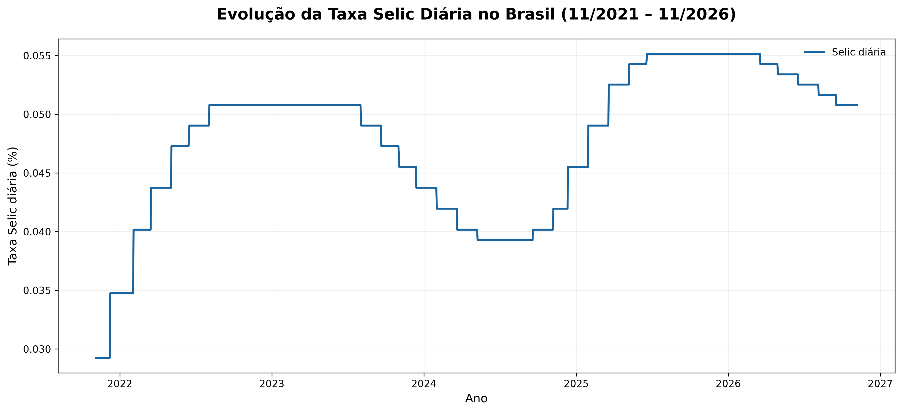
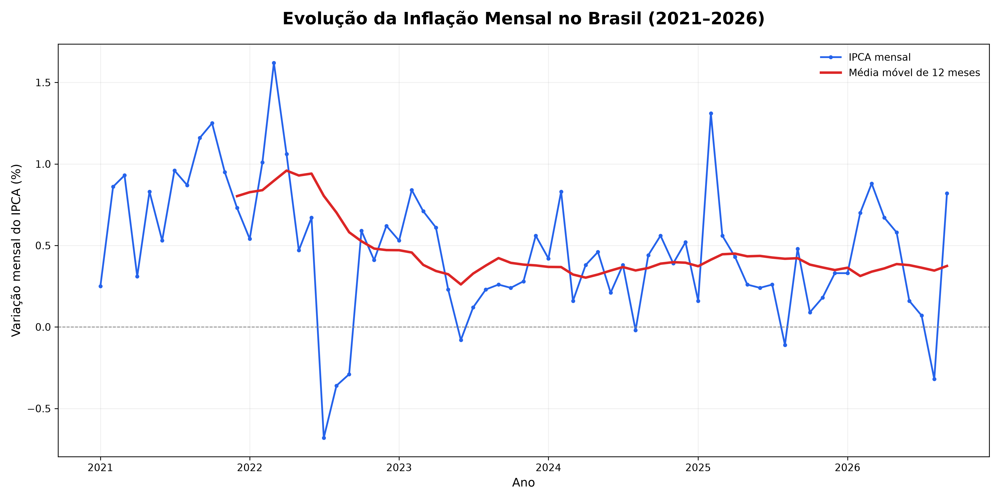
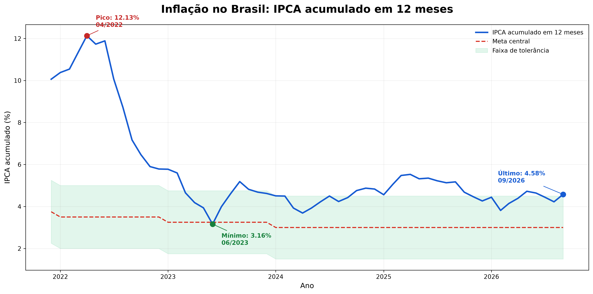
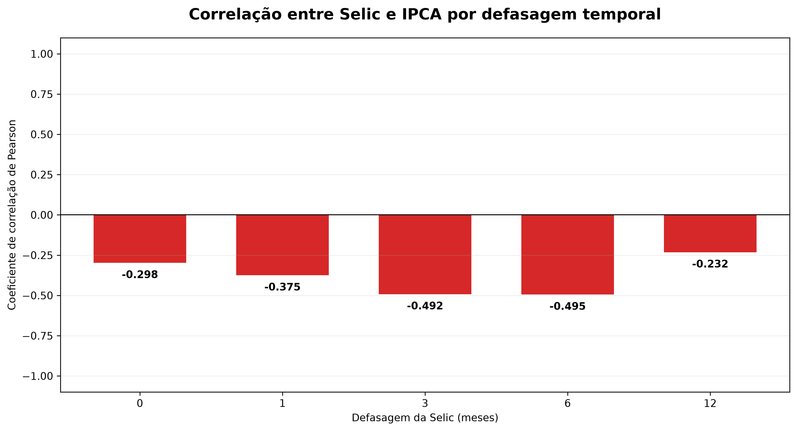
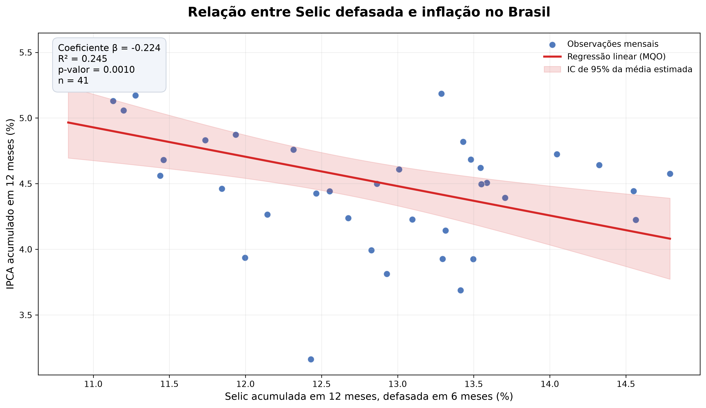
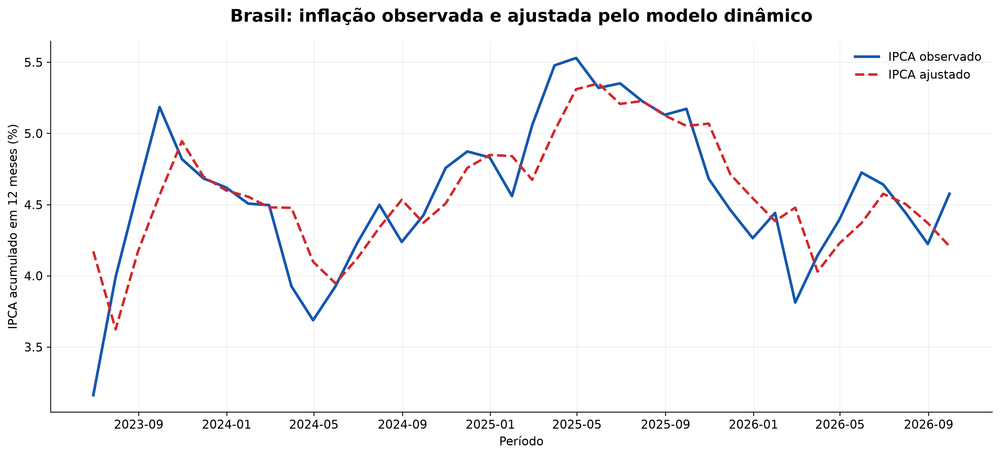
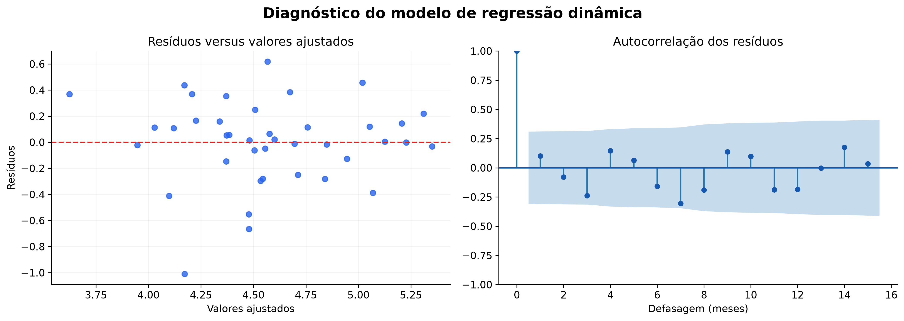
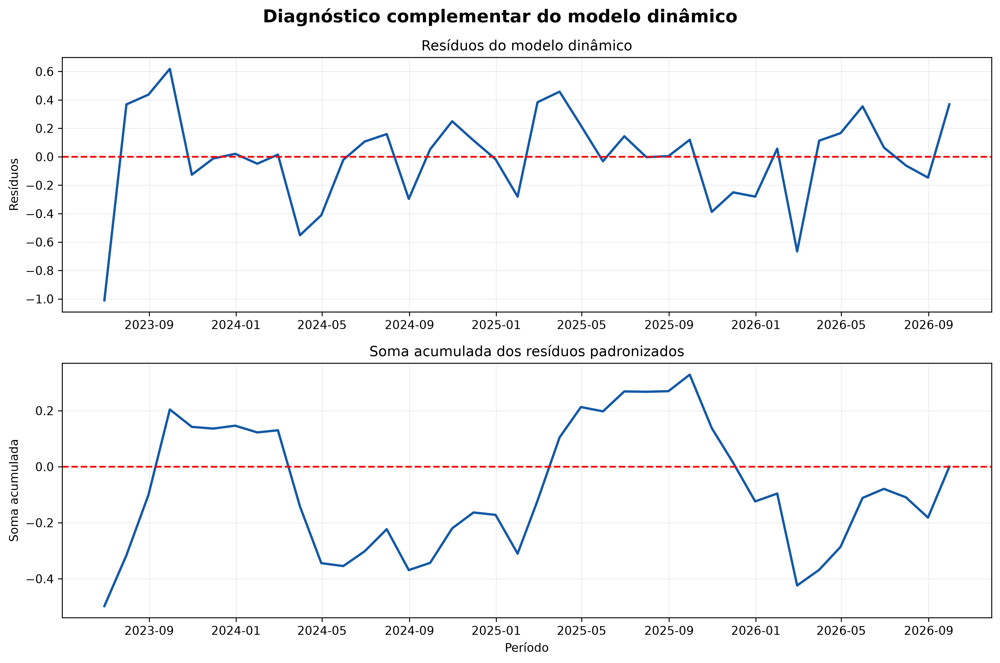

# Análise da Relação entre a Taxa Selic e a Inflação no Brasil

## 1. Apresentação do Projeto

Este projeto desenvolve uma análise quantitativa da relação entre a taxa Selic e a inflação brasileira, utilizando dados públicos oficiais e técnicas de análise estatística e econometria implementadas em Python.

O estudo contempla coleta de dados por API, tratamento e validação de bases, análise exploratória, visualização de séries temporais, correlações, modelos de regressão e procedimentos de diagnóstico estatístico.

Além da investigação econômica, o projeto busca demonstrar competências práticas em análise de dados, automação de processos, programação Python e documentação de resultados.

## 2. Objetivo

Investigar a associação estatística entre a evolução da taxa Selic e o comportamento da inflação medida pelo Índice Nacional de Preços ao Consumidor Amplo (IPCA), considerando possíveis relações defasadas entre as variáveis.

As análises têm caráter observacional e não permitem, isoladamente, estabelecer relações de causa e efeito.

## 3. Tecnologias Utilizadas

### Linguagem e bibliotecas
- **Python:** desenvolvimento dos scripts de coleta, tratamento e análise.
- **Pandas:** manipulação, organização e validação dos dados.
- **NumPy:** operações e cálculos numéricos.
- **Matplotlib:** construção de gráficos estatísticos.
- **Statsmodels:** estimação de modelos de regressão e realização de testes estatísticos.
- **Requests:** integração com APIs públicas.

### Ferramentas
- **Visual Studio Code:** ambiente de desenvolvimento.
- **Excel:** armazenamento e inspeção das bases e dos resultados.
- **GitHub:** plataforma prevista para publicação e apresentação do projeto.

## 4. Fontes dos Dados

### 4.1 Taxa Selic

Os dados da taxa Selic foram obtidos por meio da API de séries temporais do Banco Central do Brasil (SGS).

- Instituição: Banco Central do Brasil (BCB).
- Série SGS: 11.
- Indicador: Taxa de juros Selic acumulada no dia.
- Unidade de medida: percentual ao dia (% a.d.).
- Frequência: diária.
- Período da coleta: 05/11/2021 a 06/11/2026.
- Formato de obtenção: JSON, convertido para Excel com Python.

Fonte: https://dadosabertos.bcb.gov.br/

### 4.2 Inflação — IPCA

O Índice Nacional de Preços ao Consumidor Amplo (IPCA) é o indicador oficial de inflação do Brasil, produzido pelo Instituto Brasileiro de Geografia e Estatística (IBGE).

O projeto utiliza dados do IPCA para investigar sua associação com a taxa Selic, incluindo análises com inflação acumulada em 12 meses.

- Instituição responsável: IBGE.
- Indicador: IPCA.
- Frequência de referência: mensal.
- Medida adicional: inflação acumulada em 12 meses.

Fonte: https://www.ibge.gov.br/explica/inflacao.php

### 4.3 Tratamento e Validação

Os dados são processados em Python, com procedimentos de conversão de datas, tratamento de valores numéricos, ordenação cronológica e verificação de consistência.

A rotina de coleta da Selic também gera um relatório de qualidade contendo indicadores de duplicidade, valores ausentes, valores não numéricos, datas inválidas e valores não positivos.

## 5. Metodologia Estatística

### 5.1 Análise Exploratória dos Dados

Inicialmente, foram realizadas análises descritivas das séries temporais da taxa Selic e da inflação medida pelo IPCA.

Foram examinados indicadores como média, mediana, valores mínimos e máximos, desvio-padrão e evolução temporal das variáveis.

### 5.2 Análise de Correlação

Foram calculadas correlações para investigar a associação estatística entre a taxa Selic e o IPCA.

A análise considerou diferentes defasagens temporais, permitindo examinar como os movimentos das taxas de juros se relacionam com a inflação em períodos posteriores.

### 5.3 Modelos de Regressão

Foram estimados modelos de regressão linear por Mínimos Quadrados Ordinários (MQO).

Além de modelos simples, foram avaliadas especificações dinâmicas que incorporam defasagens da taxa Selic e da inflação.

Também foram calculados erros-padrão robustos à heterocedasticidade e à autocorrelação (HAC), visando tornar a inferência estatística mais adequada à estrutura temporal dos dados.

### 5.4 Diagnósticos e Validação

A avaliação estatística incluiu:

- Testes ADF e KPSS para investigar estacionariedade.
- Teste de Ljung-Box para verificar autocorrelação dos resíduos.
- Teste CUSUM para avaliar estabilidade dos parâmetros.
- Análise gráfica dos resíduos.
- Comparação entre especificações de regressão.

### 5.5 Limitações da Análise

As associações identificadas não devem ser interpretadas automaticamente como relações de causa e efeito.

A dinâmica entre política monetária e inflação envolve outros fatores econômicos, expectativas, choques externos e possíveis relações de simultaneidade.

Os resultados devem ser interpretados considerando as hipóteses dos modelos, as características das séries temporais e as limitações dos dados disponíveis.

## 6. Resultados e Visualizações

### 6.1 Evolução da Taxa Selic

A análise da série histórica permite visualizar as mudanças na taxa Selic diária ao longo do período estudado.

Os gráficos ajudam a identificar períodos de elevação, estabilidade e redução das taxas de juros.

### 6.2 Evolução da Inflação

A evolução do IPCA foi examinada por meio de gráficos temporais, incluindo a inflação acumulada em 12 meses.

Essa visualização permite identificar períodos de aceleração e desaceleração inflacionária.

### 6.3 Relação entre Selic e IPCA

Foram realizadas análises de correlação e regressão para investigar a associação entre as variáveis.

A utilização de defasagens temporais permite explorar possíveis relações entre alterações nas taxas de juros e movimentos posteriores da inflação.

### 6.4 Comparação e Validação dos Modelos

Os modelos estimados foram comparados por meio de indicadores estatísticos e procedimentos de diagnóstico.

Os resultados detalhados estão disponíveis na pasta `resultados/`, enquanto os gráficos produzidos estão organizados na pasta `graficos/`.

As evidências devem ser interpretadas considerando as limitações dos modelos e sem pressupor causalidade.

## 7. Visualização dos Resultados

### 7.1 Evolução da Taxa Selic Diária

O gráfico apresenta a evolução histórica da taxa Selic diária no Brasil, permitindo observar os movimentos das taxas de juros durante o período analisado.

### 7.2 Evolução da Inflação (IPCA)

O gráfico apresenta a evolução da inflação brasileira medida pelo Índice Nacional de Preços ao Consumidor Amplo (IPCA).

A análise permite identificar períodos de aceleração e desaceleração da inflação, contribuindo para a compreensão do cenário econômico brasileiro.

### 7.3 Inflação Acumulada em 12 Meses

A inflação acumulada em 12 meses representa a variação percentual do nível de preços ao longo de um período móvel de um ano.

Essa medida permite avaliar a persistência das pressões inflacionárias e identificar períodos de aceleração e desaceleração da inflação brasileira.

A análise dessa variável é especialmente relevante para investigar sua associação com a taxa Selic, considerando possíveis defasagens temporais.

### 7.4 Análise de Correlação entre Selic e IPCA

A análise de correlação investiga a intensidade e a direção da associação estatística entre a taxa Selic e a inflação medida pelo IPCA.

Foram consideradas diferentes defasagens temporais para examinar possíveis associações entre os movimentos das taxas de juros e o comportamento posterior da inflação.

O coeficiente de correlação permite identificar associações positivas ou negativas, mas não estabelece, isoladamente, uma relação de causalidade.

### 7.5 Análise de Regressão entre Selic e IPCA

A regressão linear foi utilizada para investigar a associação estatística entre a taxa Selic e a inflação brasileira.

O modelo permite estimar uma relação linear entre as variáveis, considerando as características da base de dados utilizada.

A análise de regressão complementa o estudo de correlação, mas seus resultados não devem ser interpretados isoladamente como evidência de causalidade.

### 7.6 Modelo de Regressão Dinâmica

Além da regressão linear simples, foram estimados modelos dinâmicos que incorporam defasagens temporais das variáveis econômicas.

Essa abordagem permite investigar a associação entre a taxa Selic e a inflação considerando informações de períodos anteriores.

A avaliação dos modelos inclui procedimentos de diagnóstico estatístico e estimativas com erros-padrão robustos à heterocedasticidade e à autocorrelação (HAC).

Os resultados devem ser interpretados considerando as hipóteses estatísticas e as limitações da modelagem.

### 7.7 Diagnóstico do Modelo Dinâmico

A avaliação do modelo de regressão dinâmica inclui a análise dos resíduos, com o objetivo de investigar possíveis padrões não explicados pela especificação estatística.

Os procedimentos de diagnóstico permitem examinar aspectos como autocorrelação, comportamento dos resíduos e adequação das hipóteses utilizadas na modelagem.

Essas verificações são importantes para avaliar a confiabilidade das inferências estatísticas e identificar possíveis limitações do modelo.

### 7.8 Validação Estatística do Modelo Dinâmico

A validação estatística foi realizada por meio de testes de estacionariedade e estabilidade dos parâmetros do modelo.

Foram utilizados os seguintes procedimentos:

- **Teste ADF (Augmented Dickey-Fuller):** investiga a presença de raiz unitária na série analisada.
- **Teste KPSS:** avalia a hipótese nula de estacionariedade.
- **Teste CUSUM:** investiga a estabilidade dos parâmetros do modelo ao longo do período estudado.

Na análise dos resíduos, o teste ADF apresentou valor-p de aproximadamente 0,0000000441, fornecendo evidências contra a hipótese de raiz unitária.

O teste KPSS apresentou valor-p reportado de 0,10, correspondente ao limite superior da tabela de referência utilizada, sem evidências suficientes para rejeitar a hipótese de estacionariedade.

O teste CUSUM apresentou valor-p de aproximadamente 0,9729, não indicando evidências estatisticamente significativas de instabilidade dos parâmetros.

## 8. Resultados Quantitativos e Interpretação Estatística

Esta seção apresenta os principais resultados quantitativos obtidos na investigação da relação entre a taxa Selic e a inflação brasileira, medida pelo IPCA.

A análise contempla modelos de regressão linear simples e dinâmica, estimativas com erros-padrão robustos HAC e procedimentos de diagnóstico estatístico.

### 8.1 Comparação dos Modelos de Regressão

A comparação dos modelos permite avaliar diferenças no desempenho estatístico das especificações consideradas.

Serão examinados indicadores de ajuste, medidas de erro e resultados dos testes de diagnóstico, respeitando as limitações de cada abordagem.

**Tabela 1 — Comparação dos modelos de regressão**

| Indicador | Modelo simples | Modelo dinâmico |
|:---|---:|---:|
| R² | 0,275141 | 0,605755 |
| R² ajustado | 0,256066 | 0,584445 |
| AIC | 49,93544 | 27,57524 |
| BIC | 53,31320 | 32,64188 |

*Fonte: elaboração própria a partir dos resultados obtidos em Python.*

O modelo dinâmico apresentou maior coeficiente de determinação
e maior R² ajustado em comparação ao modelo simples.

Também foram observados menores valores dos critérios de
informação de Akaike (AIC) e Bayesiano (BIC).

Esses resultados sugerem melhor ajuste do modelo dinâmico
aos dados analisados. A comparação dos critérios de informação
pressupõe que os modelos tenham sido estimados sobre a mesma
variável dependente e amostra.

A superioridade dos indicadores de ajuste não implica,
isoladamente, maior capacidade preditiva fora da amostra
nem comprova uma relação causal entre Selic e inflação.

### 8.2 Estimativas dos Coeficientes

As estimativas dos coeficientes serão apresentadas juntamente com seus erros-padrão e indicadores de significância estatística.

A interpretação considerará a magnitude, a direção e a incerteza das associações estimadas, sem atribuir causalidade automaticamente.

**Tabela 2 — Coeficientes do modelo dinâmico com erros-padrão robustos HAC**

| Variável | Coeficiente | Erro-padrão HAC | Valor-p | IC 95% |
|:---|---:|---:|---:|:---|
| Constante | 2,353946 | 0,686356 | 0,001499 | [0,963257; 3,744635] |
| Selic defasada em 6 meses | -0,066880 | 0,043086 | 0,129109 | [-0,154180; 0,020419] |
| IPCA defasado em 1 mês | 0,673025 | 0,057815 | 6,24 × 10⁻¹⁴ | [0,555880; 0,790170] |

*Fonte: elaboração própria com Python e estimativas robustas HAC.*

**Interpretação estatística**

A variável correspondente à Selic defasada em seis meses
apresentou coeficiente negativo (-0,066880), mas não
estatisticamente significativo ao nível de 5% (p = 0,129109).

Seu intervalo de confiança de 95% inclui zero, reforçando
a ausência de evidências estatísticas suficientes para
identificar uma associação diferente de zero nessa especificação.

Por outro lado, o IPCA defasado em um mês apresentou
coeficiente positivo (0,673025) e estatisticamente
significativo (p < 0,001).

Esse resultado sugere persistência temporal da inflação,
indicando que valores anteriores do IPCA estão associados
aos valores observados no período seguinte.

Os resultados representam associações condicionais às
variáveis incluídas no modelo e não constituem evidência
isolada de causalidade.

### 8.3 Síntese dos Resultados

A síntese reunirá as principais evidências empíricas, destacando os resultados mais relevantes, as limitações identificadas e as implicações para a análise econômica.

**Principais resultados da investigação**

A análise estatística da relação entre a taxa Selic e a inflação brasileira, medida pelo IPCA, permitiu identificar os seguintes resultados:

1. **Desempenho dos modelos:** o modelo dinâmico apresentou R² ajustado de 0,584445, superior ao valor de 0,256066 observado no modelo simples.

2. **Critérios de informação:** o modelo dinâmico apresentou menores valores de AIC (27,57524) e BIC (32,64188), favorecendo sua especificação na comparação realizada, desde que os modelos utilizem a mesma amostra e variável dependente.

3. **Selic defasada:** o coeficiente estimado para a Selic defasada em seis meses foi negativo (-0,066880), porém não apresentou significância estatística ao nível de 5% (p = 0,129109).

4. **Persistência inflacionária:** o IPCA defasado em um mês apresentou coeficiente positivo (0,673025) e estatisticamente significativo (p < 0,001), indicando associação entre a inflação atual e seus valores anteriores.

5. **Validação estatística:** os testes ADF e KPSS aplicados aos resíduos apresentaram resultados compatíveis com estacionariedade. O teste CUSUM não identificou evidências estatisticamente significativas de instabilidade dos parâmetros.

**Conclusão da análise**

Os resultados sugerem que a incorporação de informações temporais anteriores contribuiu para melhorar o ajuste estatístico do modelo dinâmico.

A persistência da inflação destacou-se como uma característica relevante dos dados analisados.

Embora o coeficiente da Selic defasada tenha apresentado sinal negativo, não foram encontradas evidências estatísticas suficientes para considerá-lo diferente de zero ao nível de significância de 5%.

Essas conclusões estão condicionadas ao período estudado, à qualidade dos dados, às variáveis selecionadas e às hipóteses da modelagem.

O estudo possui natureza observacional e não permite estabelecer, isoladamente, relações de causalidade entre política monetária e inflação.

## 9. Tecnologias e Competências Demonstradas

O projeto foi desenvolvido em Python, utilizando dados públicos brasileiros e técnicas de análise estatística para investigar a relação entre a taxa Selic e a inflação medida pelo IPCA.

### 9.1 Tecnologias Utilizadas

| Tecnologia | Aplicação no projeto |
|:---|:---|
| Python | Desenvolvimento dos scripts de coleta, processamento e análise |
| Pandas | Tratamento, organização e integração das bases de dados |
| NumPy | Operações numéricas e apoio aos cálculos estatísticos |
| Requests | Consumo da API pública do Banco Central |
| Statsmodels | Estimação de regressões e testes estatísticos |
| Matplotlib | Produção de gráficos e visualizações |
| Excel | Armazenamento e consulta das bases e dos resultados |
| VS Code | Desenvolvimento e organização do projeto |
| Markdown | Documentação técnica e apresentação dos resultados |

### 9.2 Competências Técnicas

O desenvolvimento do projeto contempla:

- Coleta automatizada de dados por API.
- Limpeza e validação da qualidade dos dados.
- Tratamento e integração de séries temporais.
- Análise exploratória e visualização de dados.
- Análise de correlação e regressão estatística.
- Modelagem dinâmica com defasagens temporais.
- Aplicação de erros-padrão robustos HAC.
- Realização de testes de diagnóstico e estacionariedade.
- Exportação de resultados para arquivos Excel.
- Documentação e comunicação de resultados analíticos.

### 9.3 Aplicação Profissional

O projeto demonstra a utilização de ferramentas de análise de dados para transformar informações públicas em resultados organizados, verificáveis e interpretáveis.

A estrutura desenvolvida pode servir de base para futuras integrações com bancos de dados SQL, painéis interativos no Power BI e rotinas de atualização automatizada.

Essas possibilidades representam etapas futuras de desenvolvimento e não funcionalidades já implementadas.

## 10. Como Executar o Projeto

### 10.1 Pré-requisitos

Para executar as análises, é necessário ter o Python instalado e um ambiente de desenvolvimento configurado.

O projeto utiliza bibliotecas para coleta, tratamento, análise estatística e visualização de dados.

As principais dependências incluem:

- pandas
- numpy
- requests
- matplotlib
- statsmodels
- scipy
- openpyxl

### 10.2 Preparação do Ambiente

Recomenda-se utilizar um ambiente virtual Python para isolar as dependências do projeto.

Após configurar o ambiente, as bibliotecas poderão ser instaladas por meio de um arquivo `requirements.txt`, contendo as dependências necessárias.

### 10.3 Execução das Análises

O fluxo de trabalho contempla as seguintes etapas:

1. Coleta de dados públicos da taxa Selic e do IPCA.
2. Validação e organização das bases.
3. Integração das séries temporais.
4. Análise exploratória e visualização.
5. Estimação dos modelos de regressão.
6. Aplicação de testes estatísticos.
7. Exportação dos resultados e gráficos.

Os scripts Python estão organizados na pasta principal do projeto, enquanto as bases de dados e os resultados são armazenados nas pastas `dados/`, `resultados/` e `graficos/`.

A execução automatizada completa do fluxo e a instalação reproduzível das dependências serão configuradas nas próximas etapas.
